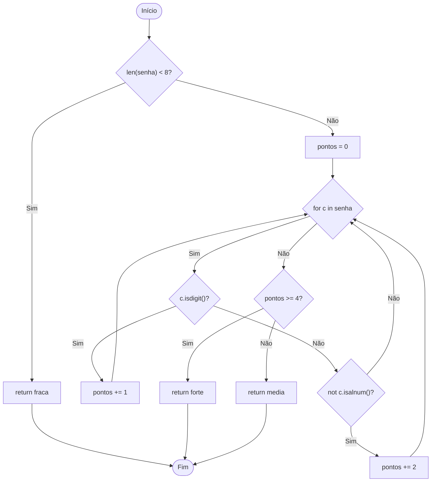

# 1- a) GFC e Complexidade Ciclomática

## Complexidade Ciclomática V(G)

**1ª Fórmula: Arestas e Nós**

V(G) = E - N + 2

- E = 17 arestas
- N = 13 nós

V(G) = 17 - 13 + 2 = **6**

**2ª Fórmula: Nós de decisão**

V(G) = P + 1

Decisões:
1. if len(senha) < 8
2. for c in senha
3. if c.isdigit()
4. elif not c.isalnum()
5. if pontos >= 4

V(G) = 5 + 1 = **6**

## b) Caminhos Independentes

Como V(G) = 6, são necessários 6 caminhos.

| Caminho | Entrada | Saída | Independência |
|---|---|---|---|
| P1 | "abc" | fraca | Senha menor que 8 |
| P2 | "abcdefgh" | media | Caminho-base |
| P3 | "abcdefghi" | media | Iteração adicional |
| P4 | "abcdefg1" | media | Ramo isdigit() |
| P5 | "abcdefg!" | media | Ramo not isalnum() |
| P6 | "abcdef!!" | forte | Ramo pontos >= 4 |

### Caminho inviável

Sim. O caminho que passa pela validação
len(senha) >= 8 e não executa o `for`
é inviável, pois uma senha com 8 ou mais
caracteres obrigatoriamente percorre o laço.

**Conclusão:** V(G) = 6, com 6 caminhos
independentes e viáveis na base escolhida.

## 2 - b) Pares independentes e conjuntos MC/DC

Expressão: `C and D and (G or P)`

### Pares independentes

| Condição | Quantidade de pares |
|---|---|
| Cartão (C) | 3 |
| Documento (D) | 3 |
| Grupo chamado (G) | 1 |
| Prioridade (P) | 1 |
| **Total** | **8** |

### Conjuntos MC/DC mínimos

Existem **4 conjuntos mínimos**, com **5 casos cada**.

Ordem: (C, D, G, P), sendo 1 = True e 0 = False.

| Conjunto | Casos |
|---|---|
| 1 | 0101, 1001, 1100, 1101, 1110 |
| 2 | 0101, 1010, 1100, 1101, 1110 |
| 3 | 0110, 1001, 1100, 1101, 1110 |
| 4 | 0110, 1010, 1100, 1101, 1110 |

São 8 pares independentes e
4 conjuntos MC/DC mínimos de 5 casos cada.

## 2 - d) MC/DC mínimo e correção

Todos os 4 conjuntos MC/DC identificaram o defeito,
pois possuem entradas que deveriam retornar True,
mas a função sempre retorna False.

O MCC sempre encontraria o erro porque testa
todas as 16 combinações possíveis (2⁴).

A correção remove o retorno antecipado e aplica
a expressão:

`cartao and documento and (grupo_chamado or prioridade)`

Após a correção, os 4 conjuntos MC/DC passam.

O MC/DC detectou o defeito com
5 casos por conjunto, enquanto o MCC utiliza
16 combinações para verificar todas as possibilidades.

## 3 - a) Definições, usos e pares DU

**Definição (def):** quando uma variável recebe um valor.
**c-use:** uso em cálculo ou retorno.
**p-use:** uso em uma condição.

| Variável | Definições | c-use | p-use |
|---|---|---|---|
| total | L2, L5, L7 | L5, L8 | L6 |
| desconto | L4 | L5 | Nenhum |

### Pares DU

| Variável | Par DU | Tipo |
|---|---|---|
| total | 2 → 5 | c-use |
| total | 2 → 6 (V) | p-use |
| total | 2 → 6 (F) | p-use |
| total | 2 → 8 | c-use |
| total | 5 → 6 (V) | p-use |
| total | 5 → 6 (F) | p-use |
| total | 5 → 8 | c-use |
| total | 7 → 8 | c-use |
| desconto | 4 → 5 | c-use |

**Total: 9 pares DU.**

## 3 - b) Pares não percorridos

A suíte atual utiliza:
- (60, True) → 50
- (200, False) → 200

Pares DU não cobertos:
- total: 2 → 6 (V)
- total: 5 → 6 (F)
- total: 5 → 8

**Conclusão:** 3 dos 9 pares DU não são cobertos.

## 3 - c) Completar All-Uses

Para completar a cobertura, adicionamos:

| Entrada | Esperado | Objetivo |
|---|---|---|
| (40, False) | 50 | Cobrir 2 → 6 (V) |
| (100, True) | 80 | Cobrir 5 → 6 (F) e 5 → 8 |

